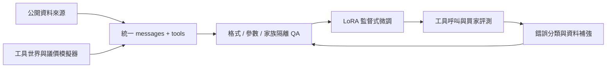

# ADL_HW3 — Tool Calling & Negotiation with LoRA

以 **Qwen3-0.6B-Base + 單一 LoRA adapter** 同時學習多輪工具呼叫與買家議價。專案包含資料轉換、可執行的合成世界、參數與家族隔離檢查、監督式微調、評測、錯誤分析及背景訓練監控。

這是 NTU ADL 2026 HW3 的實驗與程式整理。實驗使用單張 RTX 4090 24 GB、WSL2 / Ubuntu；此 repository 發布自建程式、設定與彙總結果，**不附模型權重、訓練資料、課程測試集或官方評測包**。

## 結果

| 完整公開測試 | Part 1 加權準確率 | 成交率 | 訂單正確率 | 相對成交價 ↓ | 文字合理率 |
|---|---:|---:|---:|---:|---:|
| Base，未微調 | 1.78% | 0.00% | — | — | 72.88%¹ |
| E23，第一階段 | 60.53% | **91.98%** | 97.08% | 1.0268 | 99.13% |
| E27，較高 Part 1 的實驗 | **65.61%** | 86.31% | 97.59% | 1.0303 | 99.07% |
| E28，另一種混合配方 | 64.39% | 85.27% | **97.71%** | **1.0203** | **99.43%** |
| **E29，提交包版本** | **63.81%** | **90.64%** | **97.65%** | **1.0266** | **99.39%** |

Part 1 共 13,021 步；買家評測共 8,988 步、2,607 場談判。這些是公開 benchmark 成績，並非私人測試或課程總成績。¹ Base 文字合理率只有 59 則可送判文字，不能與微調後的大量有效輸出直接比較。

E29 在工具呼叫與成交率之間取捨；65.61% 是 E27 的數字，不能與 E29 的買家結果拼成同一模型。其他 E30 實驗約 64.90–65.35%，亦未達到 70%。精確值、來源路徑與 SHA-256 見 [results.json](docs/results.json)；指標定義與限制見 [實驗結果](docs/RESULTS.md)。

## 做了什麼



- **資料管線**：整合 ToolACE、Glaive、Hermes、BFCL；第一階段 6,473 段對話、23,609 個有效目標。原始 assistant 訊息有 23,750 則，其中 141 則由 `no_target` 排除。
- **工具世界**：由程式計算工具結果與狀態轉移，涵蓋前置查核、權限、條件分支、分頁、最新參數、額度、附件與復原等流程。
- **單一 adapter、多任務**：一般工具呼叫與買家資料共同訓練；買家需根據最新報價，輸出合法訂單或繼續議價。
- **訓練細節**：只對目標 assistant 回覆計算 loss，包含結束 token；另外訓練 25 個指定 special-token embedding rows。
- **實驗工程**：固定抽樣 schedule、checkpoint、續跑、模型與資料雜湊，以及逾時、停滯、磁碟與 GPU 鎖監控。

v2 / v3 長政策教材各有 20 個領域與逐篇撰寫的政策，**屬後續資料產出，不是 E29 全部使用過的教材**。詳見 [資料與來源](docs/DATA.md)。

## 訓練設定

| 設定 | E23 | E29 |
|---|---|---|
| 起點 | Qwen3-0.6B-Base | E23 step 1475 |
| LoRA | r=32、alpha=64、dropout=0.05，模型線性層 | 相同 |
| 精度 | BF16 | BF16 |
| Learning rate | 2e-4 | 4e-5 |
| 更新次數 | 1,475 | 250 |
| 有效 batch | 16，micro-batch 2 × accumulation 8 | 相同 |
| 最長序列 | 8,192 tokens | 相同 |
| 記憶體策略 | gradient checkpointing | 相同 |

本專案實際使用 BF16 LoRA；沒有把 Base 以 4-bit 量化訓練，勿將本次結果稱為 QLoRA。

## 快速檢查

只有預測結構測試不需要 GPU、模型或課程評測包：

```bash
git clone https://github.com/forever01260407/ADL_HW3.git
cd ADL_HW3
python -B -m unittest discover -s code/audit -p test_check_predictions.py -v
```

此測試驗證缺題、重複 ID、無效欄位及未完成尾行等情況，不代表模型分數。訓練與完整評測需要另備模型、資料與課程提供的 `hw3/`。完整步驟在 [REPRODUCIBILITY.md](docs/REPRODUCIBILITY.md)，本次已做的檢查見 [VERIFICATION.md](docs/VERIFICATION.md)。

## 程式位置

| 路徑 | 用途 |
|---|---|
| `code/train.py`、`code/model_setup.py` | LoRA 訓練、loss masking、adapter 與 token rows |
| `code/data/` | 來源轉換、生成、QA、去重、BFCL 家族隔離 |
| `code/ops/` | 固定抽樣、實驗 controller、監控與故障處理 |
| `code/audit/` | 預測完整性檢查與彙總結果匯出 |
| `code/codex_eval_20261109/` | 對齊官方規則的額外評分分析 |
| `code/codex_p1_next_20261109/` | E29 使用的自然語言工作流程資料生成 |
| `code/gpt_policy_v1/` | 後續 v1/v2/v3 長政策生成、獨立政策常數與檢查 |
| `configs/` | 實驗設定；`e29.json` 為提交配方 |
| `records/*_revisions.json` | 公開來源與模型版本 pins |
| `docs/` | 最後整理、來源、結果與重現指南 |

## 實驗觀察與範圍

長政策下的工具選擇與連續呼叫是主要瓶頸。同生成器驗證集的高分未充分遷移到公開測試；增加政策文字變化的兩次短程實驗，也不足以證明它與流程多樣性的普遍重要性排序。

部分 Part 1 第一步文字確認符合這份課程評分器的特殊規則，對分數有貢獻；這不等於一般工具執行能力等幅改善。評測每步使用 gold history，不是與會即時反應的真實賣家互動。候選以自有驗證評估，最終提交版本亦參考公開結果取捨。

開發過程使用 Claude Code 與 OpenAI Codex 協助程式、教材及分析。資料與模型依其上游授權使用；課程資料、投影片、錄音、官方程式和第三方工具本體不在此重新散布，詳見 [THIRD_PARTY_NOTICES.md](THIRD_PARTY_NOTICES.md)。
